<div align="center">
  <h1>Clueterra</h1>
  <p>
    <strong>A family of geography games built around real-world data.</strong>
  </p>
  <p>
    Clueterra combines six games on one React client, a Spring Boot game API, two content services,
    AI-assisted clue operations, and an admin console for running it all.
  </p>

  <p>
    <a href="https://clueterra.com">
      
    </a>
  </p>

  <p>
    <a href="https://clueterra.com"><strong>Live app</strong></a>
    |
    <a href="#games">Games</a>
    |
    <a href="#screenshots">Screenshots</a>
    |
    <a href="#architecture">Architecture</a>
    |
    <a href="#local-development">Local setup</a>
    |
    <a href="#license">License</a>
  </p>

  <p>
    
    
    
    
    
    
  </p>

  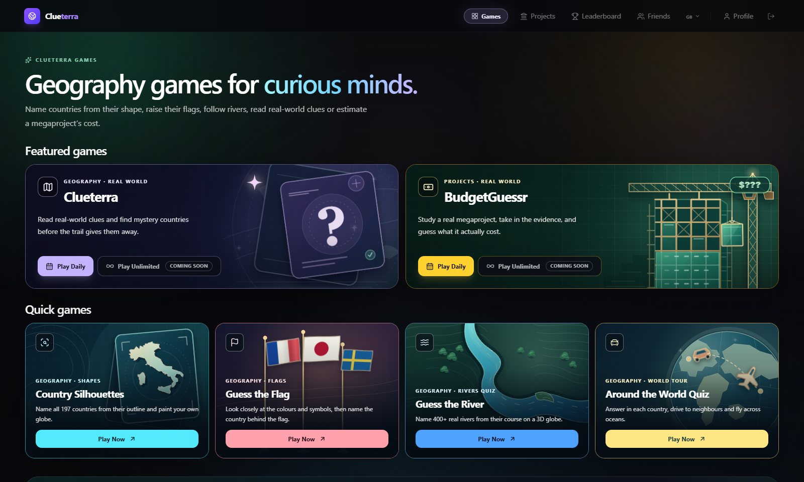
</div>

## Overview

Clueterra is built as a complete product, not just a quiz screen. It started as a daily game where players identify countries from progressively revealed clues and grew into a collection: BudgetGuessr, Country Silhouettes, Guess the Flag, Guess the River and the Around the World Quiz share one account, one daily streak, XP, badges and leaderboards. Behind them, content services sync public data, generate and review clues, keep source attribution, build daily challenges and expose admin tooling for operations.

This public edition contains the full source code. Curated datasets that took a long time to assemble (the BudgetGuessr project catalog, landmark, city, brand and fast-food lists, OpenStreetMap extracts) and the deployment scripts are not included; small sample files keep their formats so the services still start and the tests run. The production topology is published as [`deploy/docker-compose.prod.yml`](deploy/docker-compose.prod.yml).

Reuse, redistribution, commercial use, deployment, or derivative works require written permission. See [LICENSE](LICENSE).

Third-party API keys, provider data, and runtime-fetched media are not included
or licensed by this repository. Integrations must be run with the operator's own
provider accounts and under the relevant provider terms. See [NOTICE.md](NOTICE.md).

## Live App

The deployed product is available at [clueterra.com](https://clueterra.com). Review it first: the public build shows the daily game loop, progressive clue reveal, clue attribution, result sharing, profiles, and the responsive player experience.

## Highlights

<table>
  <tr>
    <td width="50%">
      <strong>Six Games</strong><br>
      Daily country clues, BudgetGuessr, Country Silhouettes, Guess the Flag, Guess the River and the Around the World Quiz, all on 3D globes or real data, sharing one streak and XP.
    </td>
    <td width="50%">
      <strong>Real-World Clues</strong><br>
      Text, image, currency, landmark, media, culture, infrastructure, biodiversity, and 360-degree panorama clues with source metadata.
    </td>
  </tr>
  <tr>
    <td width="50%">
      <strong>Progression</strong><br>
      XP, levels, streak bonuses, streak shields, public profiles, leaderboards, friends, badges, secret badges, and achievement popups.
    </td>
    <td width="50%">
      <strong>Guest-To-Account Flow</strong><br>
      Guests can play with legal acceptance, then claim progress when registering or using OAuth login.
    </td>
  </tr>
  <tr>
    <td width="50%">
      <strong>AI-Assisted Content Ops</strong><br>
      AI review and generation lanes with quotas, staged runs, token tracking, generated proposals, change sets, and approval flow.
    </td>
    <td width="50%">
      <strong>Content Operations</strong><br>
      Admin console with a content studio per game, live operation output, sync logs, hint logs, analytics, and metrics endpoints.
    </td>
  </tr>
</table>

## Games

<p align="center">
  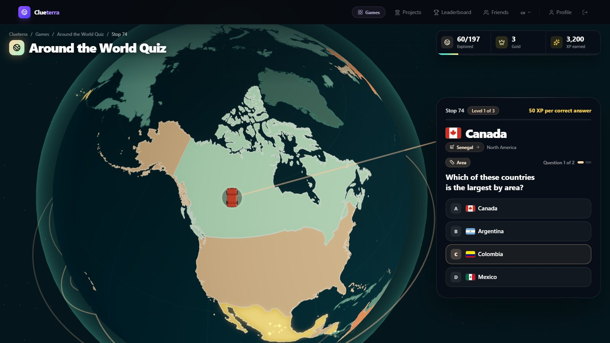
  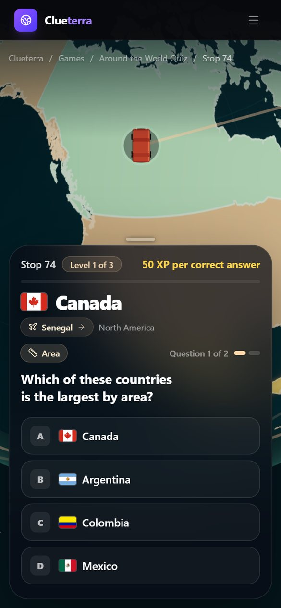
</p>

<p align="center">
  <strong>Around the World Quiz</strong> - travel country to country, answer two questions at every stop, drive over land borders or fly across oceans, and paint every country up to gold.
</p>

<table>
  <tr>
    <td width="50%">
      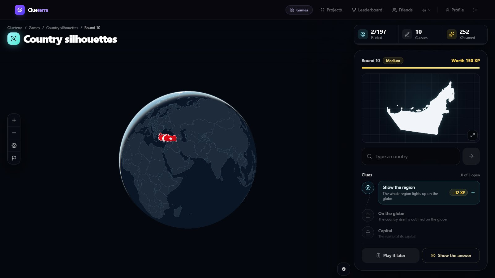
      <br><strong>Country Silhouettes</strong> - name all 197 countries from their outline and paint each one on your globe in its flag colours.
    </td>
    <td width="50%">
      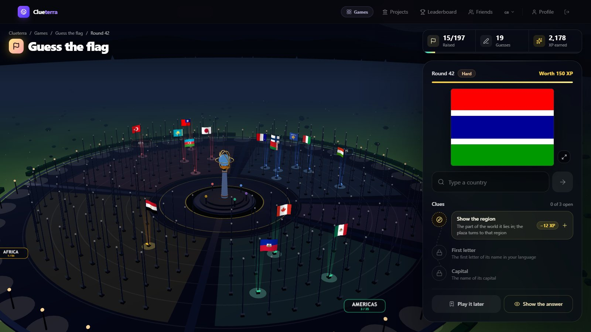
      <br><strong>Guess the Flag</strong> - name the country behind a flag and raise it on your own plaza of nations.
    </td>
  </tr>
  <tr>
    <td width="50%">
      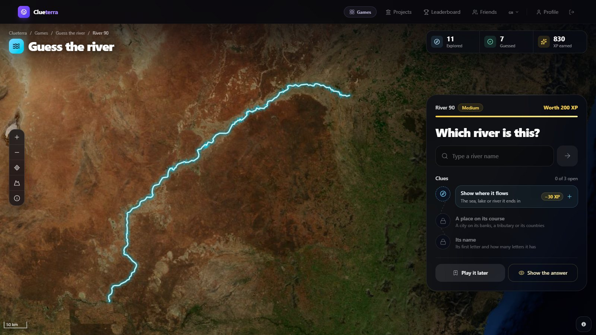
      <br><strong>Guess the River</strong> - identify 400+ rivers from 145 countries by their course on a relief globe.
    </td>
    <td width="50%">
      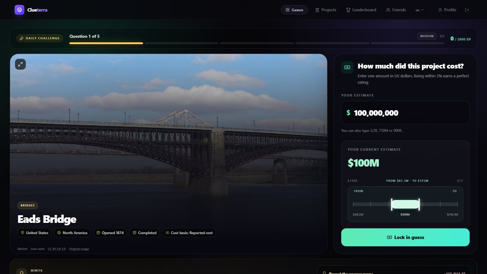
      <br><strong>BudgetGuessr</strong> - estimate what a real megaproject cost from its photo, scale and timeline, then see overruns and cost per unit.
    </td>
  </tr>
  <tr>
    <td width="50%">
      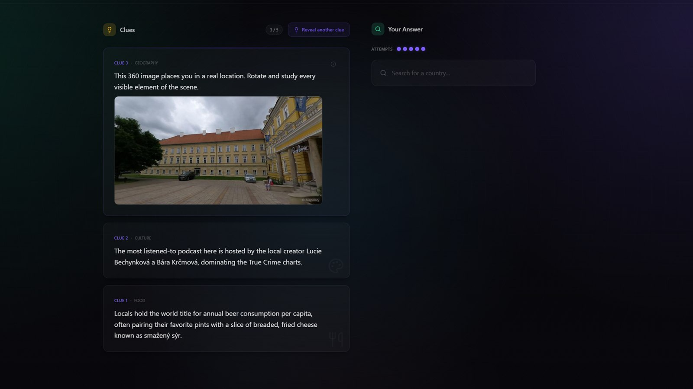
      <br><strong>Clueterra Daily</strong> - find mystery countries from progressively revealed real-world clues.
    </td>
    <td width="50%">
      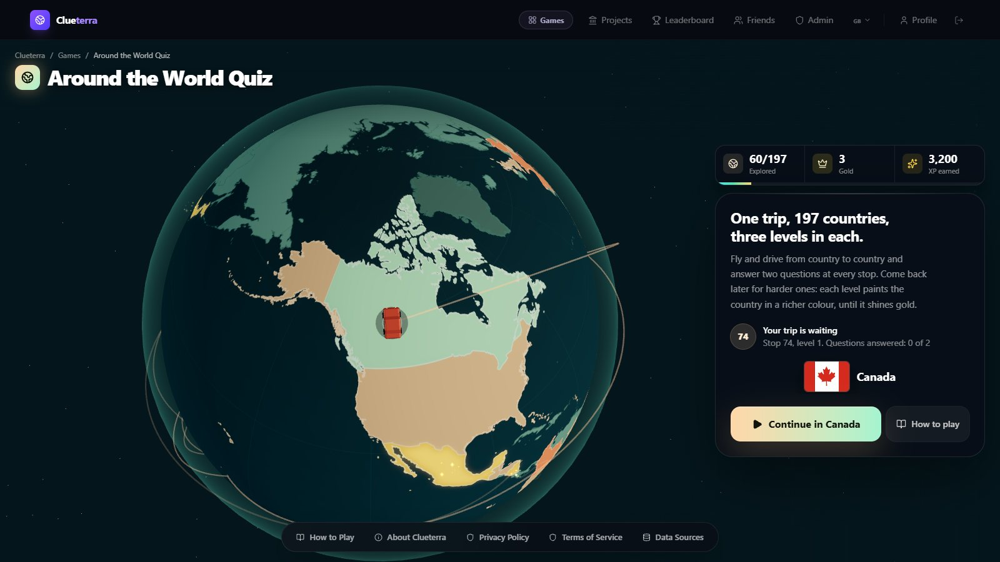
      <br><strong>Your trip on the globe</strong> - visited countries take a richer colour with every level, and the route stays on the map.
    </td>
  </tr>
</table>

Shared progression:

- One daily streak for every daily game, with streak shields and bonus XP.
- XP, levels, public profiles, leaderboards, friends, and badges across games.
- Guests can play first and claim their progress when they register.
- Shareable result cards with compact Base62 URLs and Open Graph images.
- English, Russian and Czech interface and localized SEO pages.

The daily country game rewards fast and accurate guesses with fewer revealed clues; community stats appear once enough players complete the day.

<p align="center">
  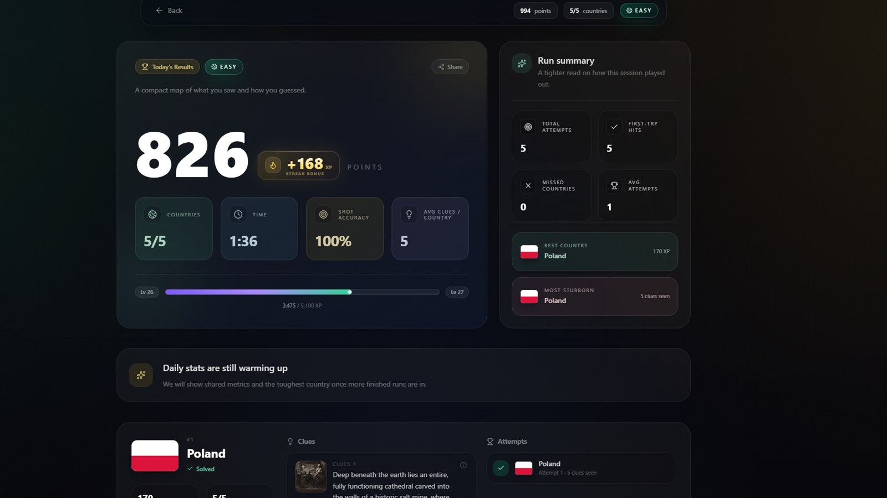
  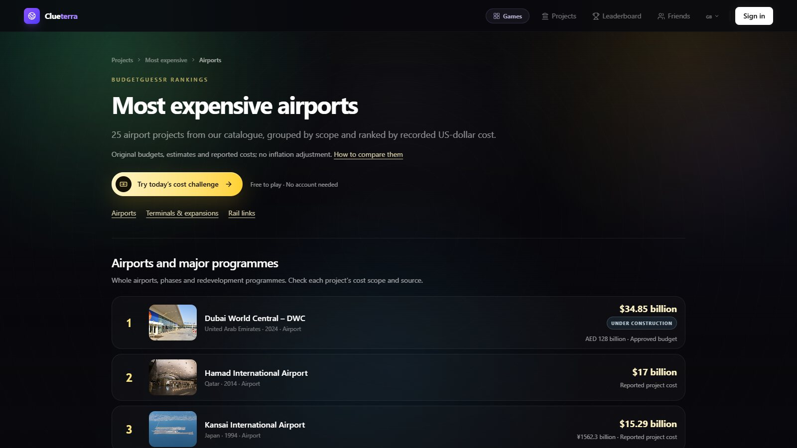
</p>

<p align="center">
  <sub>Gameplay screenshots may include captured examples of third-party clue media. See <a href="NOTICE.md">NOTICE.md</a> for attribution and reuse notes.</sub>
</p>

## Content Engine

The most important backend work is the clue pipeline. Clueterra does not depend on hardcoded trivia only; it has a dedicated questions service that turns external public data and internal engines into playable hints.

Pipeline:

1. Sync data from public APIs, curated files, and internal datasets.
2. Stage dynamic source data safely before replacing active records.
3. Enrich country statistics with ranks, percentiles, derived metrics, and image metadata.
4. Generate candidates through source-specific and generic hint lenses.
5. Score candidates by difficulty, quality, and ambiguity.
6. Deduplicate using content hashes, normalized rendered text, semantic buckets, similarity checks, and source-indicator rules.
7. Preserve image author, source page, original URL, attribution text, and license labels.
8. Build daily challenges with country rotation, region balance, difficulty bands, image quotas, dynamic-source quotas, and hint reuse cooldowns.

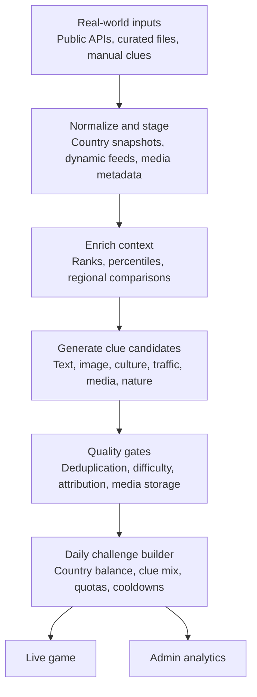

Source families include World Bank, Wikidata, Curated Country Facts, GeoNames, OpenStreetMap, CIA Factbook, Our World in Data, Big Mac Index, CityBikes, Mapillary, Wikimedia Commons, curated brands, fast-food data, combinatorics, manual entries, and AI-generated content. BudgetGuessr also uses attributed Wikipedia project descriptions and reference facts.

<p align="center">
  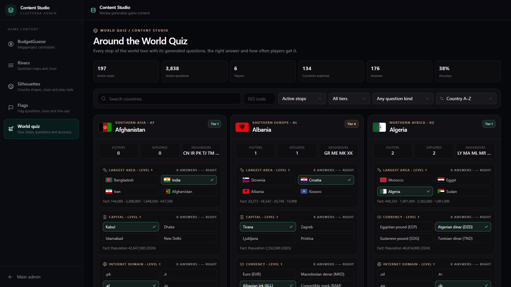
</p>

## AI-Assisted Generation

AI is treated as an operator workflow, not a blind write path. The questions service finds clue gaps, batches countries by quota and token budget, generates proposals in staged passes, validates duplicates and images, tracks model usage, and produces change sets that are visible from the admin UI.

What is implemented:

- Prompt versioning under `backend/clueterra-questions/src/main/resources/ai/prompts`.
- Country gap selection for under-covered countries.
- Draft, rescue, revision, and diversity-recovery generation phases.
- Request, token, and daily quota controls.
- Run stages with status, batch summaries, input/output token counts, and model metadata.
- Generated hint proposals with fact/evidence/duplicate-review notes.
- Wikimedia image resolution, storage, and attribution path for generated image clues.
- Admin approval, rejection, and apply flow through change sets.

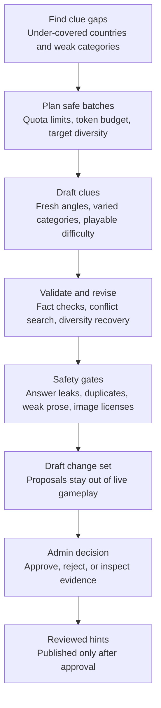

<p align="center">
  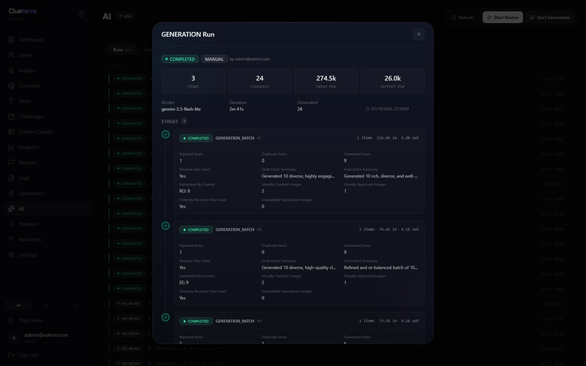
</p>

## Admin Console

The admin console is a full operations surface for running and inspecting the game:

- Content Studio: per-game review of generated content - BudgetGuessr candidates, river maps, silhouettes, flags, and world quiz questions.
- Operations: full sync, sync by source, sync by country, enrichment, hint generation, combo hints, game content generation, today/upcoming challenges.
- Hints: large searchable table, filters, sorting, column controls, image replacement, attribution metadata, activation/deactivation.
- AI: overview, run history, staged run details, change-set review.
- Challenges: generated daily challenges with country and hint breakdown.
- Analytics: sessions, completion, accuracy, hardest countries, featured countries.
- Logs: operation logs, data sync logs, hint generation logs, grouped errors.
- Badges: categories, templates, custom/secret badges, ordering, evaluation, image upload, color/effect controls.
- Settings: game tuning, XP multipliers, streak rules, registration toggle, AI toggles, audit history, cache actions.

<p align="center">
  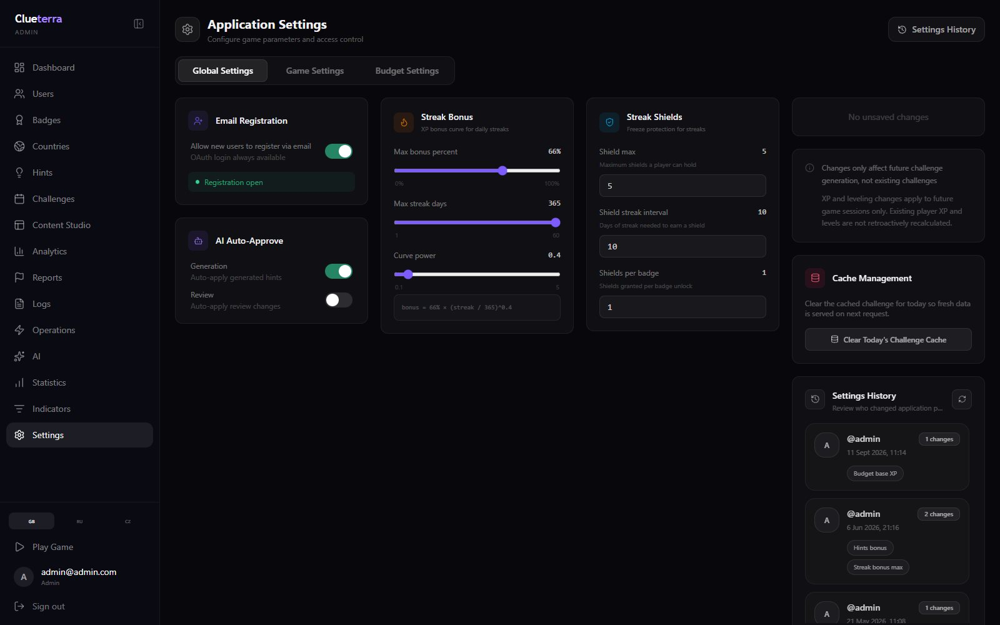
</p>

<p align="center">
  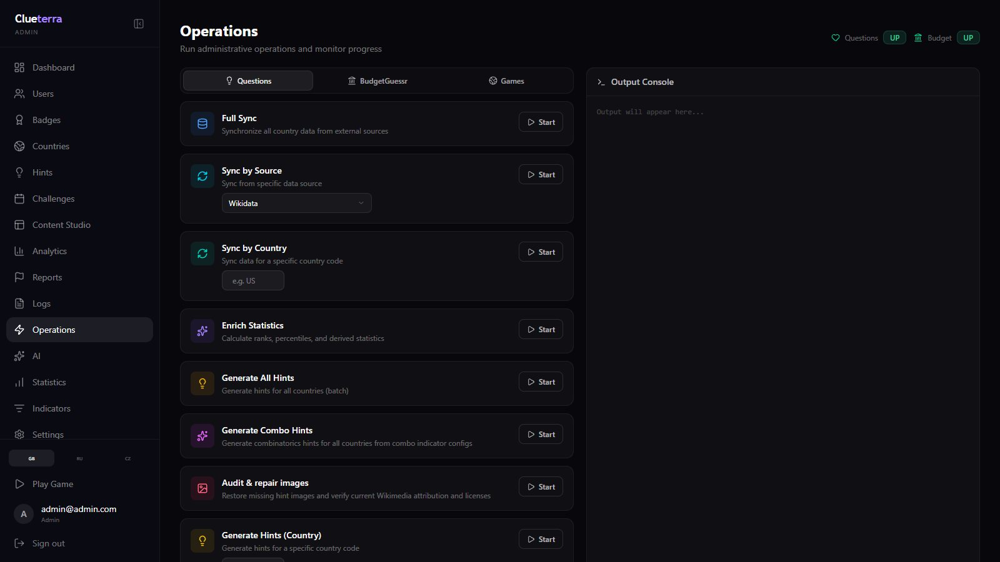
  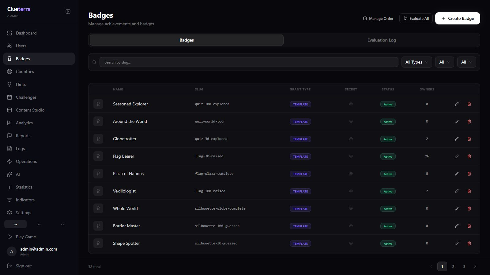
</p>

## Sharing

Completed daily runs can be shared with a compact Base62 URL; the API renders an Open Graph card for each result, so the link previews with the score in chats and social feeds.

<p align="center">
  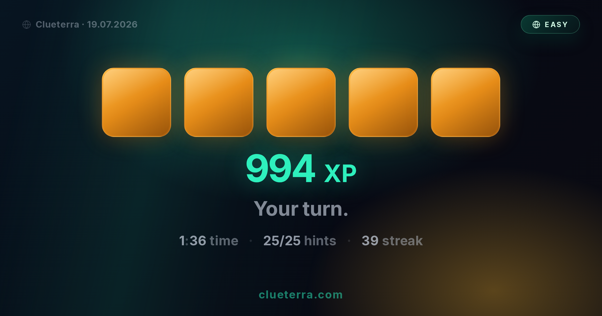
  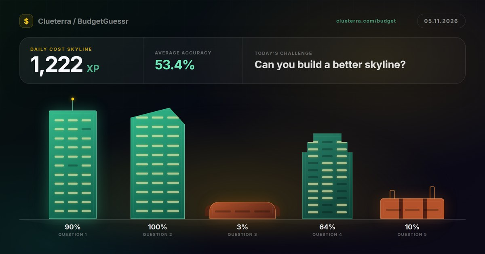
</p>

<p align="center">
  <sub>Clueterra Daily result card and the BudgetGuessr cost skyline: each building is one question, its height is the accuracy of the estimate.</sub>
</p>

## Architecture

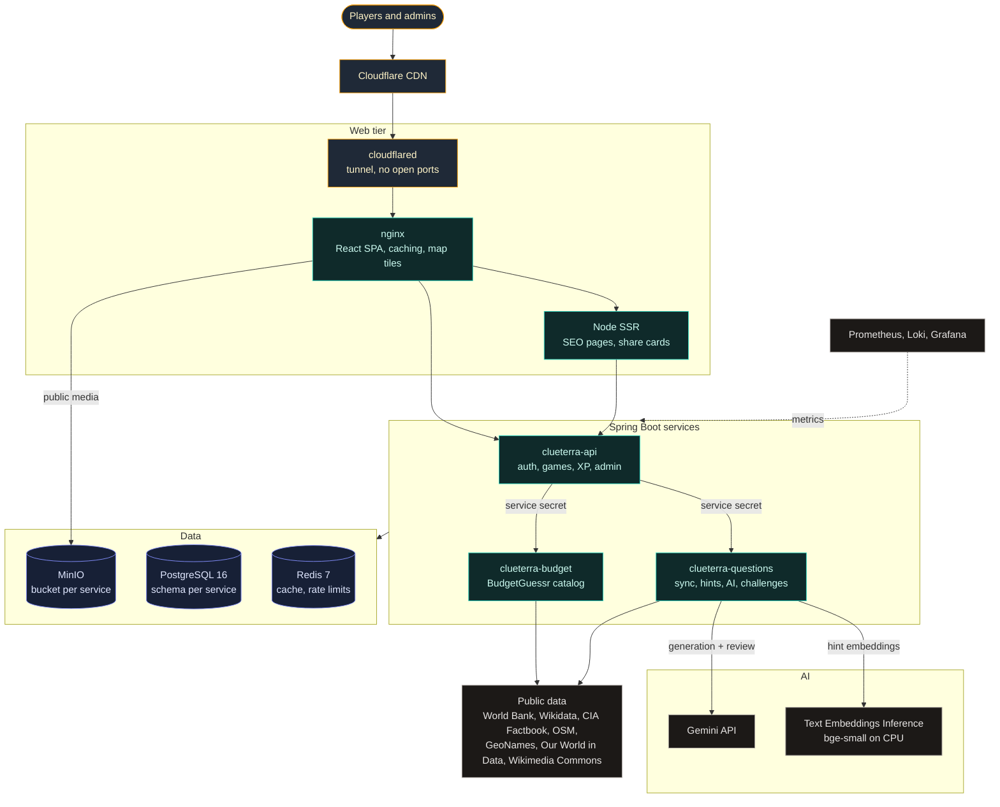

### Services

- `frontend` - nginx serving the React 19 SPA, caching hashed assets and map tiles, and proxying the API and public media.
- `frontend-ssr` - Node renderer for crawlable game, project and profile pages and Open Graph share cards.
- `clueterra-api` - Java 21, Spring Boot, auth, OAuth, TOTP, JWT HttpOnly cookies, gameplay for every game, profiles, badges, leaderboards, admin API, sharing.
- `clueterra-questions` - Java 21, Spring Boot, source sync, staging, enrichment, hint generation, AI review/generation, daily challenges, and game content for silhouettes, flags and the world quiz.
- `clueterra-budget` - Java 21, Spring Boot, priced Wikidata project ingestion, licensed image storage, immutable BudgetGuessr question generation, and synchronization audit.
- `embeddings` - Hugging Face Text Embeddings Inference with a pinned `bge-small-en-v1.5` revision; the questions service stores hint vectors for semantic duplicate checks.
- `PostgreSQL` - one database with a schema per service; BudgetGuessr runs under its own restricted role.
- `Redis` - caching, rate limiting, session and challenge caches.
- `MinIO` - object storage with separate buckets and least-privilege identities per service.

### Production Topology

[`deploy/docker-compose.prod.yml`](deploy/docker-compose.prod.yml) is the compose file the live site runs on, with every secret read from the environment.

- Only `cloudflared` talks to the internet; nginx listens on `127.0.0.1` and no other port is published.
- `frontend-net` holds nginx, SSR, the API and the tunnel, with fixed addresses so the API trusts forwarded headers only from nginx and SSR; everything else lives on the internal `backend-net`.
- PostgreSQL, MinIO and monitoring are a shared platform joined through external networks, so several projects can run on one host without each owning a database or a metrics stack.
- Every container has a read-only root filesystem, `no-new-privileges`, all Linux capabilities dropped (nginx gets back only what it needs), memory and process limits, and a health check; services start only after their dependencies report healthy.
- Spring services expose Micrometer metrics for Prometheus, Redis is scraped through `redis-exporter`, and logs are written to mounted files for the log collector.

## Tech Stack

| Area | Stack |
| --- | --- |
| Frontend | React 19, TypeScript, Vite, Tailwind CSS, TanStack Query, Zustand, Framer Motion, Recharts |
| Backend API | Java 21, Spring Boot 3.5, Spring Security, JPA/JDBC, Flyway, OpenAPI, Micrometer |
| Questions service | Java 21, Spring Boot, JDBC, JobRunr, LangChain4j Gemini, jsoup, OpenNLP, OSM tooling |
| Budget service | Java 21, Spring Boot, JDBC, Wikidata, Wikimedia Commons, Frankfurter FX, immutable question snapshots |
| Data | PostgreSQL 16, Redis 7, MinIO |
| AI | Gemini through LangChain4j, local Text Embeddings Inference (bge-small) |
| Infrastructure | Docker Compose, nginx, Node SSR, Cloudflare Tunnel |
| Observability | Micrometer, Prometheus, Loki, Grafana, redis-exporter |

## Local Development

### Prerequisites

- Java 21
- Node.js 22+
- Docker and Docker Compose

Run backend commands from the shared Maven project in `backend/`.

<details open>
<summary><strong>Linux / macOS</strong></summary>

### 1. Configure environment

```bash
cp .env.example .env
```

Replace the three `MINIO_*_SECRET_KEY` placeholders with distinct random values. Other blank API keys are optional for local integrations.
Spring applications load the root `.env` automatically when the `dev` profile is active.

### 2. Start local infrastructure

```bash
docker compose -f docker/docker-compose.yml up -d
bash scripts/configure-minio.sh
```

This starts PostgreSQL, Redis, and MinIO for local development.

### 3. Start the questions service

```bash
cd backend
./mvnw -pl :clueterra-questions spring-boot:run
```

Default port: `8081`.

### 4. Start the BudgetGuessr content service

```bash
cd backend
./mvnw -pl :clueterra-budget spring-boot:run
```

Default port: `8082`.

### 5. Start the game API

```bash
cd backend
./mvnw -pl :clueterra-api spring-boot:run
```

Default port: `8080`.

### 6. Start the frontend

```bash
cd frontend
npm ci
npm run dev
```

Default dev URL: `http://localhost:3001`.

Operational scripts:

```bash
bash scripts/configure-minio.sh
bash scripts/migrate-all.sh
bash scripts/recreate-all.sh
```

</details>

<details>
<summary><strong>Windows PowerShell</strong></summary>

### 1. Configure environment

```powershell
Copy-Item .env.example .env
```

Replace the three `MINIO_*_SECRET_KEY` placeholders with distinct random values. Other blank API keys are optional for local integrations.
Spring applications load the root `.env` automatically when the `dev` profile is active.

### 2. Start local infrastructure

```powershell
docker compose -f docker/docker-compose.yml up -d
.\scripts\configure-minio.ps1
```

This starts PostgreSQL, Redis, and MinIO for local development.

### 3. Start the questions service

```powershell
Set-Location backend
.\mvnw.cmd -pl :clueterra-questions spring-boot:run
```

Default port: `8081`.

### 4. Start the BudgetGuessr content service

```powershell
Set-Location backend
.\mvnw.cmd -pl :clueterra-budget spring-boot:run
```

Default port: `8082`.

### 5. Start the game API

```powershell
Set-Location backend
.\mvnw.cmd -pl :clueterra-api spring-boot:run
```

Default port: `8080`.

### 6. Start the frontend

```powershell
cd frontend
npm ci
npm run dev
```

Default dev URL: `http://localhost:3001`.

Operational scripts:

```powershell
.\scripts\configure-minio.ps1
.\scripts\run-dev-data.ps1
.\scripts\migrate-all.ps1
.\scripts\recreate-all.ps1
```

</details>

## Repository Map

```text
backend/              Shared Maven parent and wrapper
  clueterra-api/      Main game API: auth, gameplay, profiles, admin, sharing
  clueterra-questions/ Data sync, hint generation, AI review, daily challenges
  clueterra-budget/   BudgetGuessr content ingestion and question generation
frontend/             React game client and admin console
deploy/               Production docker-compose topology
docker/               Local PostgreSQL, Redis, MinIO and embeddings stack
scripts/              Local setup, migrations, and game catalog builders
licenses/             Third-party license texts
```

## Screenshots

Some screenshots include captured runtime clue media from sources such as
Mapillary and Wikimedia Commons. They are shown as UI examples only; the
underlying media remains subject to its original source terms and per-file
license metadata. Admin screenshots were taken on a local development database.

<table>
  <tr>
    <td width="50%">
      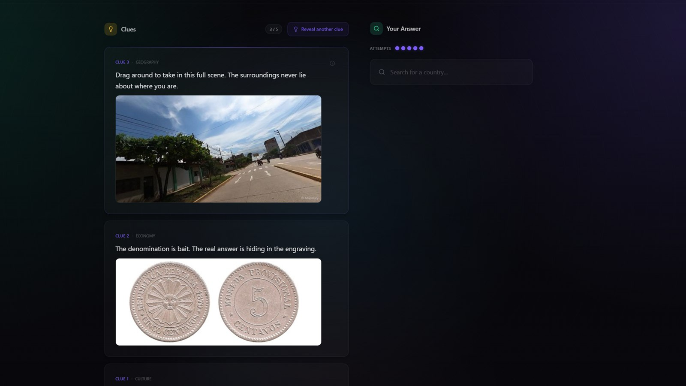
      <br><sub>Daily game: image and text clues with source attribution</sub>
    </td>
    <td width="50%">
      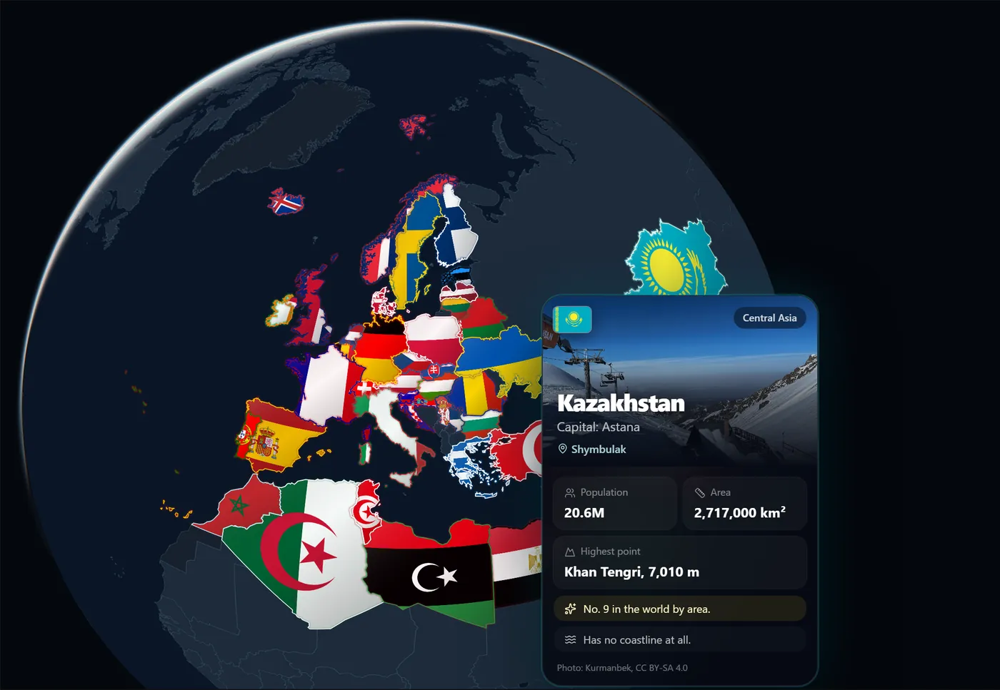
      <br><sub>Country Silhouettes: every named country is painted in its flag colours</sub>
    </td>
  </tr>
  <tr>
    <td width="50%">
      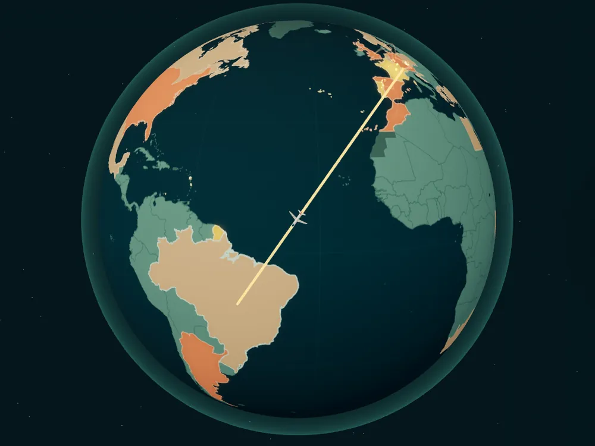
      <br><sub>Driving over land borders or flying across oceans between stops</sub>
    </td>
    <td width="50%">
      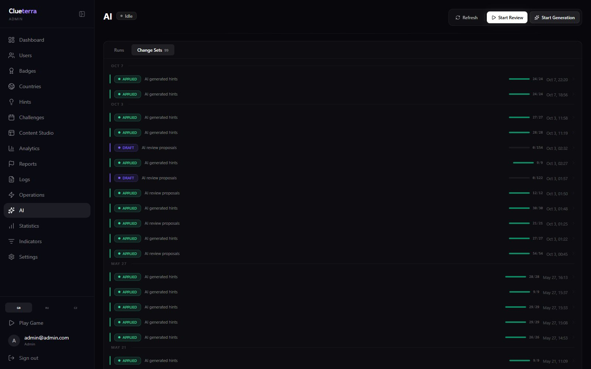
      <br><sub>AI change sets: generated and reviewed hints wait for an admin decision</sub>
    </td>
  </tr>
</table>

## License

This repository is public for source code review, portfolio review, and educational inspection only.

You may view and fork the repository through GitHub's standard functionality. You may not copy, modify, redistribute, deploy, operate, commercialize, or create derivative works from this project without prior written permission from the repository owner.

See [LICENSE](LICENSE) for the full source-available terms and [NOTICE.md](NOTICE.md) for third-party asset and data notices.
